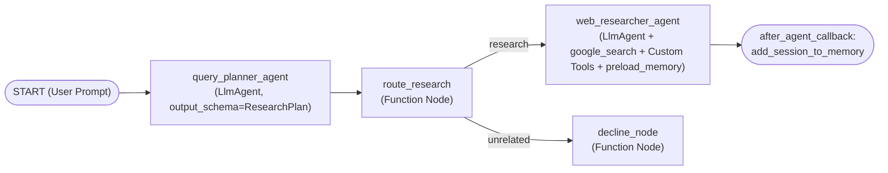

# Web Research Agent (`web-research-agent`)

A multi-agent web research system built with the [Google Agent Development Kit (ADK)](https://adk.dev/) Python 2.0 Graph `Workflow` API.

## Architecture



### Workflow Nodes & Tools

1. **`query_planner_agent` (`LlmAgent`)**: Classifies whether the user's prompt is a research inquiry (`output_schema=ResearchPlan`) and generates 2–3 targeted search queries.
2. **`route_research` (Function Node)**: Routes research queries (`route="research"`) to `web_researcher_agent` along with the planned search queries, or routes non-research prompts (`route="unrelated"`) to `decline_node`.
3. **`web_researcher_agent` (`LlmAgent`)**: Investigates the topic and synthesizes a structured Markdown brief with citations using:
   - `GoogleSearchTool(bypass_multi_tools_limit=True)` — ADK built-in Gemini Google Search grounding.
   - `search_hackernews` — Queries the public Hacker News Algolia API for practitioner discussions.
   - `search_arxiv` — Queries the public arXiv Atom API for scientific and AI/CS papers.
   - `preload_memory` & `add_session_to_memory_callback` — Recalls and saves user preferences (role, depth, formatting style) across conversations via Vertex AI Memory Bank.

## Quickstart

```bash
# 1. Install dependencies
uv sync

# 2. Configure environment (.env)
cp .env.example .env
# Edit .env to set GOOGLE_CLOUD_PROJECT=your-gcp-project-id (or GEMINI_API_KEY)

# 3. Run unit tests
uv run pytest tests/unit

# 4. Smoke test from the CLI
agents-cli run "What is retrieval-augmented generation and what are its trade-offs?"

# 5. Launch interactive web playground
agents-cli playground

# 6. Run evaluation suite
agents-cli eval run
```

## Future Enhancements
- **Scheduled Topic Monitor ("What's New Since Last Run")**: Run on a recurring Cloud Scheduler + Pub/Sub trigger, diffing against previously seen story/paper IDs in Memory Bank to notify users only when new developments appear.
- **Iterative Critique Loop**: Add a `critic_agent` node to verify coverage of all sub-questions before finalizing the brief.
