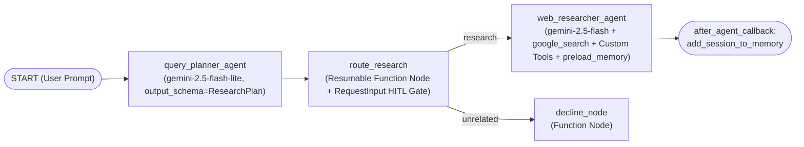

# Web Research Agent (`web-research-agent`)

A multi-agent web research system built with the [Google Agent Development Kit (ADK)](https://adk.dev/) Python 2.0 Graph `Workflow` API.

## Architecture



### Workflow Nodes, Model Routing & HITL Guardrails

1. **`query_planner_agent` (`LlmAgent`, `PLANNER_MODEL="gemini-2.5-flash-lite"`)**: Uses a fast, cost-efficient model tier for binary intent classification (`output_schema=ResearchPlan`), ambiguity detection (`needs_clarification`), and generating 2–3 targeted search queries.
2. **`route_research` (Resumable Function Node, `rerun_on_resume=True`)**:
   - **Programmatic Workflow HITL Stop (`RequestInput`)**: If a research query is ambiguous (`needs_clarification=True`) or session state requires plan sign-off (`require_plan_approval=True`), halts workflow execution via `RequestInput(interrupt_id="clarify_research_scope")` and resumes from `ctx.resume_inputs` once the user responds.
   - Routes valid research queries (`route="research"`) to `web_researcher_agent` or non-research prompts (`route="unrelated"`) to `decline_node`.
3. **`web_researcher_agent` (`LlmAgent`, `RESEARCHER_MODEL="gemini-2.5-flash"`)**: Uses a higher-capacity model tier to orchestrate multi-tool investigation and synthesize a structured Markdown brief with citations:
   - `GoogleSearchTool(bypass_multi_tools_limit=True)` — ADK built-in Gemini Google Search grounding.
   - `search_hackernews` — Queries the public Hacker News Algolia API for practitioner discussions.
   - `search_arxiv_tool` (`FunctionTool` with `require_confirmation=requires_exhaustive_search_approval`) — Queries the arXiv Atom API for scientific papers and enforces a **tool-level HITL confirmation gate** if an exhaustive sweep (`max_results > 5`) is requested.
   - `preload_memory` & `add_session_to_memory_callback` — Recalls and persists user preferences across sessions via Vertex AI Memory Bank.

## Quickstart

```bash
# 1. Install dependencies
uv sync

# 2. Configure environment (.env)
cp .env.example .env
# Edit .env to set GOOGLE_CLOUD_PROJECT=your-gcp-project-id (or GEMINI_API_KEY)

# 3. Run unit tests
uv run pytest tests/unit

# 4. Smoke test from the CLI
agents-cli run "What is retrieval-augmented generation and what are its trade-offs?"

# 5. Launch interactive web playground
agents-cli playground

# 6. Run evaluation suite
agents-cli eval run
```

## Future Enhancements
- **Scheduled Topic Monitor ("What's New Since Last Run")**: Run on a recurring Cloud Scheduler + Pub/Sub trigger, diffing against previously seen story/paper IDs in Memory Bank to notify users only when new developments appear.
- **Iterative Critique Loop**: Add a `critic_agent` node to verify coverage of all sub-questions before finalizing the brief.
